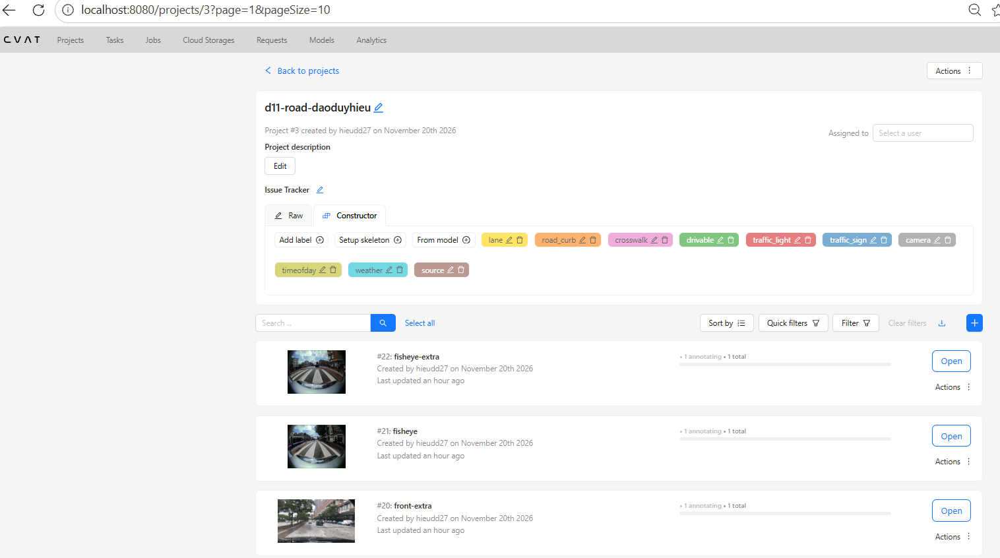
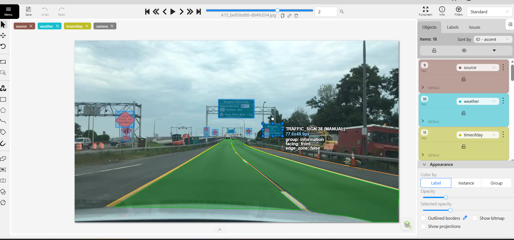
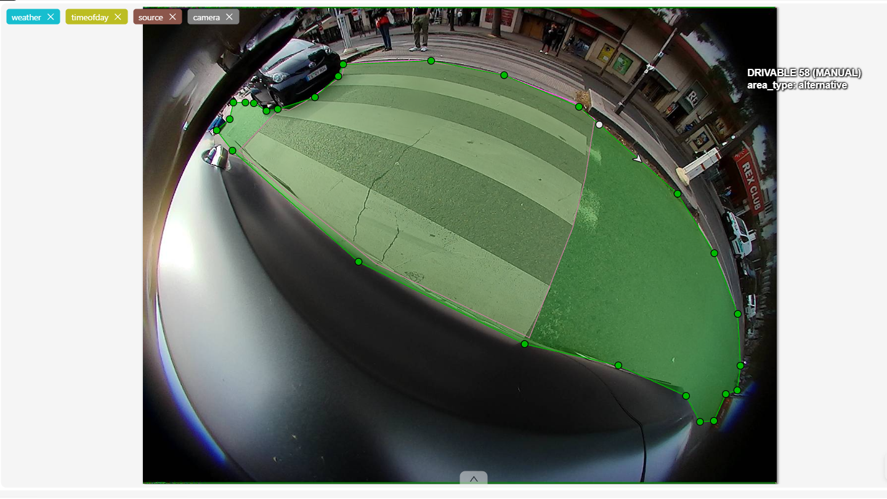
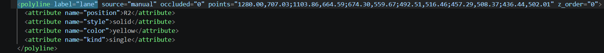

# Báo cáo cá nhân — Ngày 11

Họ tên: Đào Duy Hiếu  
Mã học viên: 2A202603235  
Phiên bản CVAT (Help → About): 2.82.0 (môi trường lab)  
Guideline: Road v1.0  
Lần nộp (`revision` trong manifest): 2  
Thời điểm export: 22/11/2026 07:42 (Asia/Saigon; bản front mới nhất)  
Số lần nộp lại sau Rework: 1

## 1. Kiểm project

| Mục | Đúng như guideline Road v1.0? | Ghi chú |
| --- | --- | --- |
| 6 label, đúng kiểu | Có | lane/road_curb: polyline; crosswalk/drivable: polygon; traffic_light/traffic_sign: rectangle. |
| Thuộc tính và giá trị | Có | Đã kiểm bằng `road_check lint`. |
| 4 tag ảnh | Có | 28/28 ảnh đủ camera, timeofday, weather, source. |

Cách kết thúc polyline trên bản CVAT này: nhấn `N`.  
Cách đặt tag ảnh trên bản CVAT này: chọn công cụ Tag, chọn label, sau đó kiểm tra thuộc tính `value` trong Details.

## 2. Số lượng đã gán

| Task | Ảnh | lane | road_curb | crosswalk | drivable | traffic_light | traffic_sign |
| --- | ---: | ---: | ---: | ---: | ---: | ---: | ---: |
| front | 12 | 36 | 4 | 5 | 26 | 25 | 9 |
| front-extra (đã làm 4 / 4) | 4 | 12 | 3 | 4 | 11 | 5 | 8 |
| fisheye | 8 | 7 | 7 | 6 | 11 | 2 | 5 |
| fisheye-extra (đã làm 4 / 4) | 4 | 0 | 0 | 4 | 4 | 0 | 0 |

## 3. Bảng ca khó

| Ảnh | Nhãn | Phân vân giữa | Đã chọn | Lý do |
| --- | --- | --- | --- | --- |
| A05 | lane | Thiếu L1/R1 hay không có vạch nhìn thấy | Không vẽ lane | Ảnh không có vạch sơn L1/R1 rõ; không vẽ tưởng tượng. |
| A06 | lane | Thiếu L1/R1 hay biên không liên tục tại giao lộ | Không bổ sung L1/R1 | Đã kiểm tra trực quan nhưng không thấy vạch L1/R1 đủ rõ để gán. |
| A07 | biên trái | lane L1 hay road_curb sát barrier | lane L1 | Có biên sơn trắng nhìn thấy dọc barrier. |
| A08 | lane L1 | Hai polyline độc lập hay một vạch bị tách/trùng | Giữ để chờ đối chiếu | Lint cảnh báo cùng position L1; cần coach/GT xác nhận trước khi gộp hoặc xóa. |
| A09 | lane | Thiếu R1 hay biên phải không phải vạch lane | Không bổ sung R1 | Đã kiểm tra trực quan nhưng không thấy vạch R1 đủ rõ để gán. |
| A14 | lane | Thiếu R1 ở ảnh extra | Không bổ sung R1 | Đã kiểm tra trực quan nhưng không thấy vạch R1 đủ rõ để gán. |
| B07–B08 | lane | Đoạn thẳng ít điểm hay polyline theo cung | Polyline nhiều điểm, position=other | Camera hai bên; guideline yêu cầu bám cung và dùng position=other. |

**Ghi chú cảnh báo QC1-02:** Đã kiểm tra lại trực quan A05, A06, A09 và A14. Không thấy các vạch làn tương ứng (A05: L1/R1; A06: L1/R1; A09: R1; A14: R1) đủ rõ trong ảnh nên không thể gán mà không suy đoán; vì vậy giữ nguyên nhãn thay vì tự vẽ thêm vạch không nhìn thấy.

## 4. Phiếu QC 1 nhận được

Bạn kiểm lô của tôi: Nguyễn Đức Anh  
Quyết định nhận được: Rework

| Mã lỗi | Số lỗi | Đồng ý? | Đã sửa? |
| --- | ---: | --- | --- |
| QC1-02 | 1 | Có | Có — bổ sung L1 ở A07. |
| QC1-05 | 1 | Có | Có — bỏ polyline L2 bị trùng ở A01. |
| QC1-11 | 5 | Có | Có — thêm điểm bám cung ở B02, B07 và B08. |

## 5. Kiểm file export

| File | Mở lại được? | Số shape ảnh 1 (job / file) | Số shape ảnh 2 (job / file) | Tag camera có trong XML? |
| --- | --- | --- | --- | --- |
| `daoduyhieu-front.zip` | Có | 9 / 9 | 6 / 6 | Có |
| `daoduyhieu-fisheye.zip` | Có | 4 / 4 | 5 / 5 | Có |

Manifest xác nhận: front 16 ảnh, fisheye 12 ảnh, `contains_images=false`, mọi ảnh đủ bốn tag.

## 6. Ảnh chụp màn hình

1. Tab Labels của project: 
2. Một ảnh camera trước đã gán đủ: 
3. Một ảnh fisheye đã gán: 
4. Một đoạn XML có `<polyline label="lane">`: 

## 7. Tự đánh giá

Lỗi mắc nhiều nhất: QC1-11 — polyline fisheye ban đầu có quá ít điểm. Cách tránh ở Ngày 20 là phóng to vùng cong, đặt thêm điểm ở vòng ngoài và tự kiểm lại toàn bộ cung trước khi chuyển ảnh.

Nhãn lane được dùng để huấn luyện mô hình phát hiện làn hoặc sinh mục tiêu row-anchor. Nếu polyline có quá ít điểm hoặc không bám cung fisheye, mô hình học biên làn bị kéo thẳng và dự đoán sai vị trí làn, đặc biệt ở rìa ảnh; điều này có thể làm hệ thống giữ làn ước lượng sai quỹ đạo.

## 8. (Tùy chọn, buffer) Từ polyline đến đích row-anchor

Không thực hiện; mục này không tính điểm.
